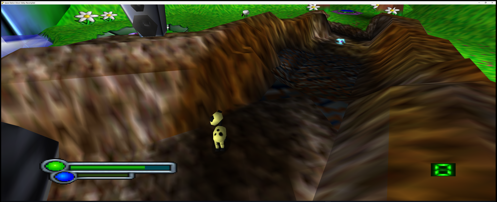
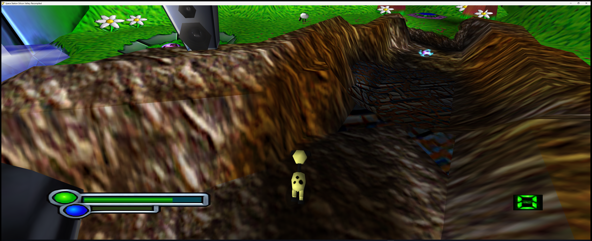
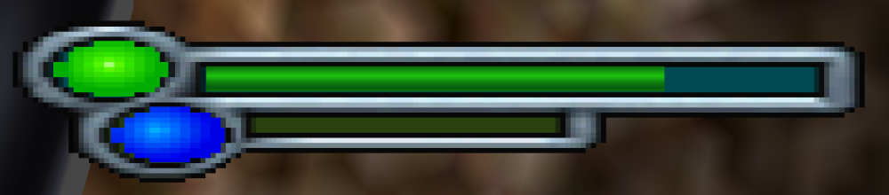
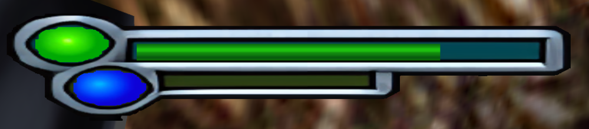

# Space Station Silicon Valley: Recompiled - 4x Textures

A **texture-only fork** of [Cellenseres/SSSV_Recomp](https://github.com/Cellenseres/SSSV_Recomp).
It supplies an optional **4x AI-upscaled texture pack** for the original recompilation.
**No gameplay, executable, renderer, audio, models, or game-code changes are introduced by this fork.**
Use the upstream game with this pack; no different executable is needed.

## Download and install

1. Install [the upstream recompilation](https://github.com/Cellenseres/SSSV_Recomp/releases/tag/v0.2.0)
   and supply your own supported **US 1.0 ROM**. Tested with Windows v0.2.0.
2. Download **[SSSV_4x_AI_Textures.rtz](https://github.com/vending-machine-git/SSSV_Recomp-4x-Textures/releases/download/4x-textures-v1.0.0/SSSV_4x_AI_Textures.rtz)**
   from this fork's [texture release](https://github.com/vending-machine-git/SSSV_Recomp-4x-Textures/releases/tag/4x-textures-v1.0.0).
   Approximately **157 MiB**. Do not extract or rename the `.rtz`.
3. Close the game, then copy the file into the game's **`mods`** directory:
   - Portable: `mods` beside the game executable.
   - Windows: `%LOCALAPPDATA%\SSSVRecompiled\mods`.
   - Linux: `~/.config/SSSVRecompiled/mods`.
   - macOS: `~/Library/Application Support/SSSVRecompiled/mods`.
4. Enable **Silicon Valley 4x AI Textures** in the launcher's **Mods** menu.
   Avoid enabling another pack that replaces the same textures simultaneously.
5. Disable this mod to return to native textures. Saves and the ROM are unchanged.

Only the Windows portable configuration has been exercised locally. Other platforms need
an upstream build with compatible RT64 texture-pack support and have not been runtime-tested here.
The release contains replacement textures, **not a ROM, model weights, or a game executable**.

### Optional integrity verification

The release includes `SHA256SUMS.txt`. [The manifest](texture-pack/manifest.json) records
the archive size, SHA-256, mapping count, and image count. From a checkout, with Python 3.11+:

```sh
python -m pip install -r texture-pack/requirements.txt
python texture-pack/verify.py /path/to/SSSV_4x_AI_Textures.rtz
```

The verifier checks SHA-256, every archive entry's CRC, metadata, all replacement bindings,
and BC7 DDS mip chains. It never changes your installation. RT64 uses Zstandard ZIP entries,
which ordinary ZIP tools may not open; install the `.rtz` directly rather than unpacking it.

## Screenshot comparisons

These are **actual in-game captures**, not generated mockups or offline texture previews.
They show **Smashing Start** with RT64 replacements disabled and enabled in the same session.
The camera/animation moved slightly between captures; these are not pixel-aligned A/B frames.
No sharpening, recoloring, or retouching was applied. Open an image to inspect it at full size.

| Native textures | 4x upscaled textures |
| --- | --- |
|  |  |
|  |  |

The second row is an **unscaled, identical-coordinate HUD crop** from the full screenshots.
See [capture provenance and coordinates](texture-pack/verification.json).
Comparison captures are from November 13, 2026; the same pack was smoke-tested again in
Smashing Start on November 19, 2026, with settings and saves restored afterward.

## What's included

- **35,601 RT64 v5 replacement mappings** and **35,433 BC7 DDS images** with complete mip chains.
- Built from **4,268 4x source PNGs**, with **3,261 distinct source paths** bound to native
  textures; mappings include palette variants and atlas subrectangles.
- Upscaled terrain, artwork, fonts, HUD, and effects where verified bindings exist.
- RT64 low-mip cache and streaming configuration, preserved transparency, separate color/mask
  textures, and intensity-format handling.

This is **not a claim of 100% coverage**. Runtime-generated water, framebuffers, unmatched data,
and unseen dynamically modified palettes can remain native. Four-times dimensions do not mean
four-times screen resolution or new geometry. No unrelated mods are bundled.

## Processing and credits

Stylized textures use a 50:50 blend of **UniScale Balanced / Restore** by **kim2091**
(model license: **CC-BY-NC-SA-4.0**). Indexed inputs use **DitherDeleterV3 Smooth** by
**mutin-choler** (**WTFPL**). Pre-rendered artwork uses **SGI** by **chrisnonyminus**
(**GPL-3.0-only**). Alpha was processed separately, with binary-alpha preservation,
transparent RGB filling, 16-pixel inference padding, and regenerated mip levels.

These are model authors' stated licenses, not a claim to ownership of the original game
artwork or a blanket license for this pack. Game artwork belongs to its respective rights
holders. No model weights or ROM are distributed. This is an unofficial fan project,
not an official release or endorsement. Do not assume commercial-use rights.

The fork publishes the finished pack, validation tooling, and screenshot evidence, **not**
the original ROM, extracted source assets, model installations, or full local build workspace.
The manifest identifies the exact artifact. Thanks to all upstream recompilation,
decompilation, N64Recomp, and RT64 contributors.

The original port documentation follows; its feature lists describe upstream capabilities,
not additional changes made by this texture fork.

---

## Upstream port documentation
Space Station Silicon Valley: Recompiled is a project that uses [N64: Recompiled](https://github.com/N64Recomp/N64Recomp) to **statically recompile** Space Station Silicon Valley into a native port with many new features, enhancements, and extensive mod support. This project uses [RT64](https://github.com/rt64/rt64) as the rendering engine to provide graphical enhancements.

### For the original executable, use the upstream project's Releases section.

### **The original game is required to build or run the port. This fork's texture release contains replacement artwork, but no ROM or executable.**

## Table of Contents
* [System Requirements](#system-requirements)
* [Features](#features)
  * [Plug and Play](#plug-and-play)
  * [Faithful Audio](#faithful-audio)
  * [Easy-to-Use Menus](#easy-to-use-menus)
  * [High Framerate Support](#high-framerate-support)
  * [Low Input Lag](#low-input-lag)
  * [Instant Load Times](#instant-load-times)
  * [Linux and Steam Deck Support](#linux-and-steam-deck-support)
* [Planned Features](#planned-features)
* [FAQ](#faq)
* [Known Issues](#known-issues)
* [Building](#building)
* [Libraries Used and Projects Referenced](#libraries-used-and-projects-referenced)

## System Requirements
A GPU supporting Direct3D 12.0 (Shader Model 6), Vulkan 1.2, or Metal Argument Buffers Tier 2 support is required to run this project. The oldest GPUs that should be supported for each vendor are:
* GeForce GT 630
* Radeon HD 7750 (the one from 2012, not to be confused with the RX 7000 series) and newer
* Intel HD 510 (Skylake)
* A Mac with Apple Silicon or an Intel 7th Gen CPU with MacOS 13.0+

On x86-64 PCs, a CPU supporting the SSE4.1 instruction set is also required (Intel Core 2 Penryn series or AMD Bulldozer and newer). ARM64 builds will work on any ARM64 CPU.

If you have issues with crashes on startup, make sure your graphics drivers are fully up to date. 

## Features

#### Plug and Play
Simply provide your copy of the North American 1.0 version of the game in the main menu and start playing! This project will automatically load assets from the provided copy, so there is no need to go through a separate extraction step or build the game yourself.

#### Faithful Audio
Music and sounds are perfectly faithful to the original N64 version of the game, with all audio processing intact and no popping or stuttering. Scenes that synchronize audio to visuals have their timings corrected to ensure they remain synchronized as they did on original hardware.

#### Easy-to-Use Menus
Gameplay settings, graphics settings, input mappings, and audio settings can all be configured with the in-game config menu. The menus can all be used with mouse, controller, or keyboard for maximum convenience.

#### High Framerate Support
Play at any framerate you want thanks to functionality provided by RT64! Game objects and terrain, texture scrolling, screen effects, and all HUD elements are all rendered at high framerates. By default, this project is configured to run at your monitor's refresh rate. You can also play at the original framerate of the game if you prefer. **Changing framerate has no effect on gameplay.**

**Note**: External framerate limiters (such as the NVIDIA Control Panel) are known to potentially cause problems, so if you notice any stuttering then turn them off and use the manual framerate slider in the in-game graphics menu instead.


#### Low Input Lag
This project has been optimized to have as little input lag as possible, making the game feel more responsive than ever!

#### Instant Load Times
Saving and loading files, going from place to place, and pausing all happen in the blink of an eye thanks to the game running natively on modern hardware.

#### Linux and Steam Deck Support
A Linux binary as well as a Flatpak is available for playing on most up-to-date distros, including on the Steam Deck.

To play on Steam Deck, extract the Linux build onto your deck. Then, in desktop mode, right click the SSSVRecompiled executable file and select "Add to Steam". From there, you can return to Gaming mode and configure the controls as needed.

## Added Features
* Widescreen Support

## Planned Features
* Bugfixes regarding visual glitches
* Ray Tracing via RT64

## FAQ

#### What is static recompilation?
Static recompilation is the process of automatically translating an application from one platform to another. For more details, check out the full description of how this project's recompilation works here: [N64: Recompiled](https://github.com/Mr-Wiseguy/N64Recomp).

#### How is this related to the decompilation project?
Unlike N64 ports in the past, this project is not based on the source code provided by a decompilation of the game. This is because static recompilation bypasses the need for decompiled source code when making a port, allowing ports to be made **without source code**. However, the reverse engineering work done by the decompilation team was invaluable for providing some of the enhancements featured in this project. For this reason, the project uses headers and some functions from the decompilation project in order to make modifications to the game. Many thanks to the decompilation team for all of the hard work they've done.

#### Where is the savefile stored?
- Windows: `%LOCALAPPDATA%\SSSVRecompiled\saves`
- Linux: `~/.config/SSSVRecompiled/saves`
- macOS: `~/Library/Application Support/SSSVRecompiled/saves`

#### How do I choose a different ROM?
**You don't.** This project is **only** a port of Space Station Silicon Valley, and it will only accept one specific ROM: the US 1.0 version of the N64 release of Space Station Silicon Valley. ROMs in formats other than .z64 will be automatically converted, as long as it is the correct ROM. **This is not an emulator, and it cannot run any arbitrary ROM.**

Instead, you can change the game by installing mods. See the [mod support](#mod-support) section for details.

#### Can you run this project as a portable application?
Yes, if you place a file named `portable.txt` in the same folder as the executable then this project will run in portable mode. In portable mode, the save files, config files, and mods are placed in the same folder as the executable.

## Known Issues
* Overlays such as MSI Afterburner and other software such as Wallpaper Engine can cause performance issues with this project that prevent the game from rendering correctly. Disabling such software is recommended.

## Building
Building is not required to use the texture pack: use the executable from [upstream releases](https://github.com/Cellenseres/SSSV_Recomp/releases). This fork's releases provide the texture pack only. Upstream's build workflow requires private content and is not run in this fork; game code is unchanged.

## Libraries Used and Projects Referenced
* [N64Recomp](https://github.com/N64Recomp/N64Recomp) for statically recompiling the game's code to run natively
* [RT64](https://github.com/rt64/rt64) as the project's rendering engine (via our fork with added S2DEX support, which Space Station Silicon Valley uses frequently for sprite/background rendering)
* [N64ModernRuntime](https://github.com/N64Recomp/N64ModernRuntime) for replacing the original N64 runtime libraries and providing mod support
* [RecompFrontend](https://github.com/N64Recomp/RecompFrontend) for menus and input handling
* Space Station Silicon Valley decompilation project for headers and some function definitions, used for making patches or some enhancements

#### What are F3DEX and S2DEX?
F3DEX is a Fast3D "extended" RSP microcode/GBI used for the game's 3D display lists.  
S2DEX is a sprite/background-focused RSP microcode/GBI designed for 2D rendering (sprites and BG operations). Space Station Silicon Valley uses S2DEX frequently, so we maintain a custom RT64 fork that adds S2DEX support.
